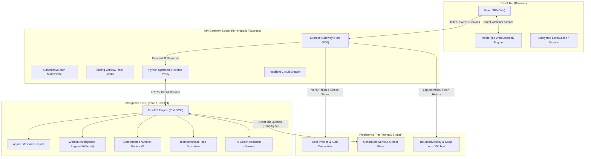
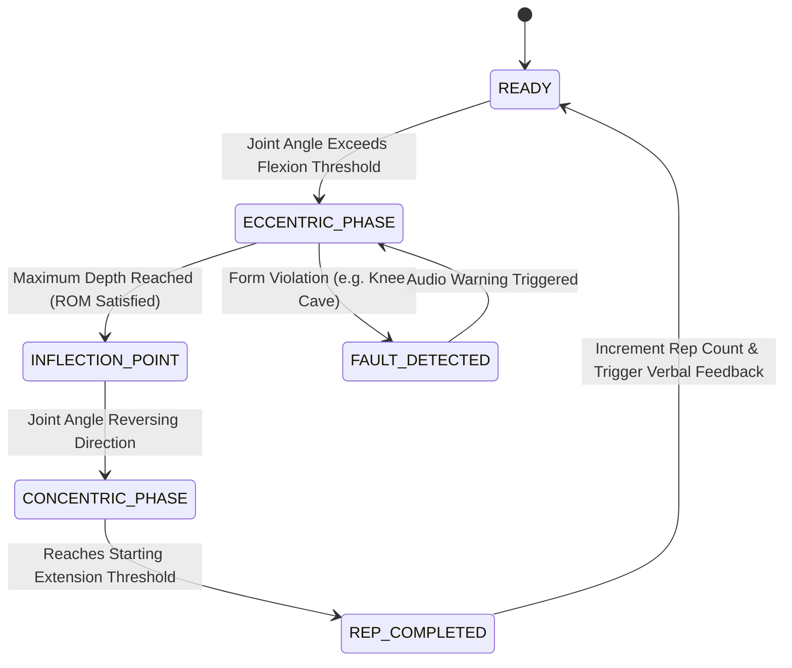
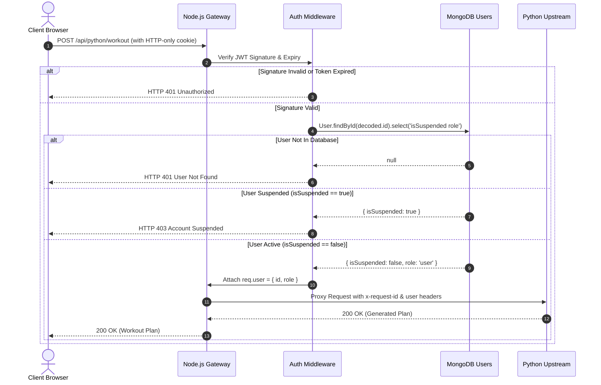

# FINAL PROJECT ARCHITECTURE REPORT
## Elevate Fitness & Nutrition Intelligence Platform

> **Date:** November 20, 2026  
> **Status:** Current Production Architecture  
> **Repository:** `Elevate-fitness`  

---

## 1. System Overview & Macro Architecture

Elevate is a high-performance, full-stack intelligence platform delivering hyper-personalized fitness workout plans, dynamic nutrition blueprints, real-time AI computer vision rep tracking, and an interactive fitness assistant.

The platform employs a decoupled three-tier microservice architecture:
1. **Frontend Tier (React + Vite):** Modern Single-Page Application (SPA) structured by modular feature domains.
2. **Backend Orchestration Tier (Node.js + Express):** Central API gateway, identity & access management, session authority, rate limiter, and upstream reverse proxy.
3. **Machine Learning & Algorithmic Tier (Python + FastAPI):** High-throughput numerical computation engine hosting multi-output XGBoost models, biomechanical pose tracking state machines, and combinatorial meal generators.



---

## 2. Frontend Architecture (`frontend/`)

### 2.1 Feature-Sliced Domain Architecture
The frontend codebase has transitioned from monolithic pages to feature-sliced domain modules in `frontend/src/features/`:

```
frontend/src/
├── api/                     # Modular API communication layer
│   ├── apiClient.js         # Base Axios client with CSRF & interceptors
│   ├── authApi.js           # Identity and session endpoints
│   ├── profileApi.js        # User metrics and avatar endpoints
│   ├── workoutApi.js        # Workout generation and variation endpoints
│   ├── nutritionApi.js      # Meal plan and food database endpoints
│   ├── adminApi.js          # Admin dashboard and telemetry endpoints
│   ├── chatbotApi.js        # AI chat streams and history endpoints
│   └── index.js             # Central export barrel
├── features/                # Domain-specific modular business logic & UI
│   ├── dashboard/           # Dashboard sub-components & hero config
│   │   ├── ActivityChart.jsx    # Standalone SVG spline chart
│   │   ├── heroActionConfig.js  # Radial score & water goal calculations
│   │   └── index.js
│   ├── nutrition/           # Nutrition sub-components & helpers
│   │   ├── MacroStat.jsx        # Reusable macro ring cards
│   │   ├── MealCard.jsx         # Meal table & portion control
│   │   ├── MealSwapModal.jsx    # Alternative food picker
│   │   ├── HistoryPanel.jsx     # 7-day nutrition drawer
│   │   ├── nutritionHelpers.js  # IST/UTC date math & intensity
│   │   ├── nutritionServing.js  # Serving size normalizer
│   │   ├── nutritionStyles.js   # Glassmorphic style definitions
│   │   └── index.js
│   ├── pose-detection/      # Biomechanics & computer vision
│   │   ├── poseMath.js          # Joint angle math & EMA smoothing
│   │   ├── formSafety.js        # Form validation & safety verbal cues
│   │   ├── repCounterMachine.js # Hysteresis finite state machine
│   │   ├── poseDrawing.js       # Skeleton & HUD canvas renderer
│   │   └── index.js
│   └── workout/             # Workout plan sub-components & modals
│       ├── AnimatedImageSequence.jsx # Canvas exercise animation loop
│       ├── DaySelector.jsx           # Weekly workout cards grid
│       ├── RestDaySwapModal.jsx      # Safe rest-day scheduling
│       ├── SwapHistoryModal.jsx      # Swap audit trail drawer
│       ├── ExerciseVariationModal.jsx# AI progression/regression
│       ├── workoutConstants.js       # Exercise metadata & status
│       ├── workoutStyles.js          # Visual styles
│       └── index.js
├── pages/                   # Page view entrypoints (Dashboard, Workout, Nutrition, etc.)
└── components/              # Shared design system components (Navbar, AuroraBackground, etc.)
```

### 2.2 Biomechanical Rep Counting State Machine
Real-time rep counting uses a robust finite state machine with hysteresis damping to eliminate false rep counts caused by camera noise or tremor:



---

## 3. Node.js Gateway & Orchestration Architecture (`backend-node/`)

### 3.1 Security & Authoritative Authentication Flow
All client requests pass through the Node.js API Gateway, where authoritative security checks occur:



### 3.2 Python Reverse Proxy & Circuit Breakers
To prevent cascade failures if the Python ML engine experiences CPU-bound saturation or cold starts:
- Requests routed through `backend-node/routes/pythonProxy.js`.
- Configured with a 120-second timeout.
- Client-side and server-side circuit breakers protect against spamming failed upstream instances during warmups.

---

## 4. Python Machine Learning & Algorithmic Tier (`backend-python/`)

### 4.1 Modern FastAPI Lifespan Lifecycle
Server startup and teardown are orchestrated through a single unified `lifespan(app: FastAPI)` async context manager:

```python
@asynccontextmanager
async def lifespan(app: FastAPI):
    # 1. Connect to MongoDB Atlas
    await connect_to_mongo()
    # 2. Trigger asynchronous model warm-up in background thread
    warmup_info = _trigger_model_warmup(background=True)
    # 3. Start keep-alive loop for cloud platform idling prevention
    pinger_task = asyncio.create_task(_keep_alive_loop())
    yield
    # 4. Graceful shutdown: cancel pinger, flush connection pools
    pinger_task.cancel()
    await close_mongo_connection()
```

### 4.2 Machine Learning Feature Pipeline (`feature_pipeline.py`)
User profile metrics are transformed into fixed-dimension numerical vectors for XGBoost multi-output models:
1. **Validation & Normalization:** Age, weight, height, BMI, sleep scores, and hydration scores sanitized.
2. **Derived Features:** Recovery score (sleep, hydration, stress, fatigue), readiness score, progressive overload delta, age-adjusted capacity.
3. **Deterministic Categorical Encoders:**
   - `experience_encoder`: Fitted on `['Beginner', 'Intermediate', 'Advanced']`.
   - `goal_encoder`: Fitted on 6 standard goals.
   - `equipment_encoder`: Pre-fitted on 21 canonical equipment items; unknown items safely filtered without throwing `UserWarning` or modifying output vector dimensions.
   - `injury_encoder`: Pre-fitted on 14 canonical injury/pain categories.

### 4.3 Deterministic Nutrition Engine V6
Meal plans are synthesized using a multi-pass combinatorial constraint satisfaction algorithm:
1. **Target Calculation:** Mifflin-St Jeor BMR calculation with activity and goal multipliers.
2. **Template Matching:** Selects weekly templates satisfying dietary preferences (Non-Veg, Veg, Vegan).
3. **Candidate Plate Generation:** Evaluates proteins, carbohydrates, fibers, and fats.
4. **Scoring & Penalization:** Penalizes duplicate meals across adjacent days, flags unharmonious food pairings, and enforces a 0.00% fallback rate.
5. **Portion Optimization:** Solves exact gram weights using linear constraints to match macro targets within ±2%.

---

## 5. Persistence Tier & Data Protection

- **Storage Engine:** MongoDB Atlas with Mongoose schemas in Node.js and Motor async client in Python.
- **Unbounded Array Protection:** Activity arrays use `$push` with `$slice: -100` to prevent documents from growing past BSON limits.
- **Session Revocation:** Logout routes explicitly delete HTTP-only cookies on the client side with strict matching paths and domains.
